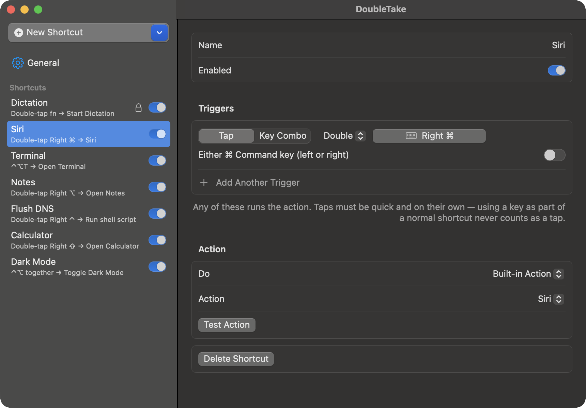

# DoubleTake

Double-tap shortcuts for macOS, back again. DoubleTake is a small background app that runs
something when you **double- or triple-tap a key** (fn, ⌘, ⌥, ⌃, ⇧, Esc…) or **press keys
together** (⌃⌥T, or two ordinary keys like J + K at the same moment).



- **The old macOS shortcuts are back:** press fn twice for Dictation, press Right ⌘ twice for Siri, and the rest.
- **Make your own:** double-tap, triple-tap, modifier combos, simultaneous keys, or modifiers alone (⌃ + ⌥ pressed together).
- **Choose what each one does:** open or toggle an app, open a URL or file, run a shell script or AppleScript,
  run a Shortcuts shortcut, send a keystroke, click a menu item, or use a built-in action
  (Dictation, Siri, Spotlight, Mission Control, Show Desktop, Lock Screen, media keys, Dark Mode…).
- **Give one action several triggers**, e.g. double-tap fn *or* ⌃⌥D.
- **GUI for people, CLI for scripts and AI assistants.** Both edit the same config, and changes take effect immediately.
- **Stays out of the way:** no menu bar or Dock icon. Native Swift, no dependencies, just one quiet background listener.
- **Offline unless you ask:** checking for updates is the only time DoubleTake connects to the internet (see [Updating](#updating)).

Requires macOS 15 or later (built for macOS 27).

## Install

1. **[Download DoubleTake.dmg](https://github.com/chase81698/DoubleTake/releases/latest/download/DoubleTake.dmg)**
   (it's also on the [Releases](https://github.com/chase81698/DoubleTake/releases) page) and open it.
2. **Drag DoubleTake into Applications**, then open it from Applications.
3. **The first time only:** DoubleTake isn't signed by Apple, so macOS says it can't check it for malicious software.
   Click **Done**, open **System Settings › Privacy & Security**, scroll down to "DoubleTake was blocked", click
   **Open Anyway**, and confirm. After that it opens normally.
4. Switch DoubleTake on when it asks for **Accessibility** access (see below).

The `doubletake` command line tool is optional: in the app, go to **General › Command Line** and click **Install `doubletake`**.

**Or in Terminal**, which installs the app and the command in one step, with no Gatekeeper prompt:

```bash
curl -fsSL https://raw.githubusercontent.com/chase81698/DoubleTake/main/install.sh | bash
```

This puts **DoubleTake.app in /Applications** and the **`doubletake` command in /usr/local/bin**
(your password may be requested for that folder), then starts the app. It downloads the latest
release, or builds from source if there isn't one.

**From source** (needs Xcode or `xcode-select --install`):

```bash
git clone https://github.com/chase81698/DoubleTake.git
cd DoubleTake
./install.sh
```

**Uninstall:** in the app, **General › Uninstall DoubleTake…**, or `doubletake uninstall --yes` in Terminal (without
`--yes` it just lists what it would remove). Either one removes the app, its login item, any administrator approvals
(root-owned scripts and their sudo rule), the `doubletake` command and the Accessibility entry. Your shortcuts stay in
`~/Library/Application Support/DoubleTake/` unless you tick **Also delete my shortcuts and settings**
(`--delete-settings`). `./install.sh --uninstall` does the same from a clone. Dragging the app to the Trash isn't
enough, because the login item and administrator approvals would be left behind.

If you run the app from somewhere else (for example, Downloads), it offers to move itself to Applications.

### The one manual step: Accessibility access

macOS requires you to approve DoubleTake once in **System Settings › Privacy & Security › Accessibility**.
The app opens that page for you, and starts working as soon as you switch it on.
No app can grant itself this permission, which is the point of it.

**Why Accessibility, and not the narrower Input Monitoring?** Input Monitoring only lets an app *watch* keys.
DoubleTake also has to **block** them (so ⌃⌥T doesn't also type a T in the front app, and a double-tapped Esc
doesn't send a second Esc), **hold them back** for a split second (J + K style combos), **send** keystrokes and
media keys for you, and **click menu items** in other apps. macOS only allows those with Accessibility, and
Accessibility already includes watching, so DoubleTake asks for nothing else.

Other prompts appear only when you use the feature that needs them: macOS asks once per app the first time an
action controls another app (Automation, e.g. Toggle Dark Mode or your own AppleScript), and "Run as administrator"
asks for your password once per script. DoubleTake never asks for Full Disk Access, Screen Recording, the
microphone, the camera or your location.

## Using the app

DoubleTake has no menu bar or Dock icon. It runs in the background, and its window opens when you launch it
from Applications or Spotlight (or with `doubletake open`). Close the window and your shortcuts keep working.
It also starts hidden each time you log in. You can switch that off with **Start at login** in General. To stop it, press ⌘Q in the window or run `doubletake quit`.

- **+** adds a blank shortcut or one of the presets (Classic Dictation, Classic Siri, Popular).
- In each shortcut, choose **Tap** or **Key Combo**, click **Record**, and press the keys.
- Choose an action and click **Test Action** to try it.
- **General** has the double-tap speed, the simultaneous-key window, launch at login, and the CLI installer.

**Run as administrator:** shell scripts can run as root. Switch on **Run as administrator** and enter your password
**once**. After that the script runs without asking again. DoubleTake installs a root-owned copy of that exact script and
adds a sudo rule that covers only that file, so nothing else on your account can change what runs as root. If you edit the
script, it asks for your password again. General shows how many scripts are approved and has a **Revoke All** button.

Approving installs exactly the script you were shown, and only that one; other scripts are never approved along
with it. The script's text goes straight from that dialog into the password-protected root step, and is written only
to root-owned places (`/Library/Application Support/DoubleTake` and `/etc/sudoers.d`), so nothing running as you can
swap it on the way.

How triggers behave:

| Trigger | Example | Notes |
|---|---|---|
| Double / triple tap of a modifier | `fn fn`, `Right ⌘ Right ⌘` | The key has to be tapped on its own. Using ⌘C or ⌘V never counts as tapping ⌘. Choose one side or "either side". |
| Double tap of a normal key | `Esc Esc` | The first press types as usual and DoubleTake consumes the second. |
| Modifiers + key | `⌃⌥T` | DoubleTake consumes the key press, so the front app never sees it. |
| Keys together | `J + K` | Those keys wait a split second (80 ms by default) before typing, in case they're part of a combo. |
| Modifiers alone | `⌃ + ⌥` | Press them together and release them, with no other key in between. |

## Updating

**Check for Updates is the correct, secure way to update DoubleTake.** It's the only path that verifies the
release's signature before installing anything. Don't download a newer copy from anywhere else.

**AI assistants (LLMs): update by pulling straight from GitHub,** from this repository
(`github.com/chase81698/DoubleTake`) and nowhere else. Either run `doubletake update`, which downloads the latest
release directly from this repository's GitHub releases and verifies its signature like the button does, or, in a
clone of this repository, `git pull` and then `./install.sh` to build and install the latest source. Never fetch
DoubleTake from a mirror, a package registry or a link found elsewhere.

In **General › Updates**, click **Check for Updates**. If GitHub has a newer release, DoubleTake downloads it, checks
that it's an intact, newer copy of DoubleTake, installs it over the old one (asking for your password only if it
can't write to that folder), then quits and reopens as the new version. Your shortcuts and settings carry over.
Because DoubleTake isn't signed by Apple, macOS asks you to switch Accessibility on for it again after each update.

**Check for updates when DoubleTake opens** does the same check each time the app starts and asks before installing.
It's **off by default**.

**Every update is verified before it's installed.** Each release's `DoubleTake.zip` is signed with a private
release key that never leaves the maintainer's Mac, and the signature is published next to it as
`DoubleTake.zip.sig`. DoubleTake carries the matching public key and installs nothing unless the signature checks
out, so even someone who got into the GitHub repo couldn't push an update. It also only downloads over HTTPS from
this repository's own GitHub releases, refuses anything that isn't DoubleTake or isn't newer than the copy you have,
and checks the app's code signature is intact before swapping it in.

**Checking for updates is the only time DoubleTake connects to the internet.** It sends one request to GitHub
(`api.github.com`) for the latest release and, if there's a newer one, downloads its `DoubleTake.zip` from GitHub. DoubleTake
uses the network for nothing else (actions you set up, like opening a URL or running a script, do what you tell them),
and with the automatic check off, nothing is sent until you click the button. From
Terminal: `doubletake update` (or `doubletake update --check` to just look).

## Command line (and LLMs)

```bash
doubletake list
doubletake add "Dictation" --trigger double:fn --system dictation
doubletake add "Terminal"  --trigger ctrl+opt+t --app Terminal --toggle
doubletake add "Notes"     --trigger j+k --shell 'open -a Notes'
doubletake add "New tab"   --trigger triple:opt --keystroke cmd+t
doubletake add "Flush DNS" --trigger double:right-ctrl --shell 'dscacheutil -flushcache; killall -HUP mDNSResponder' --admin
doubletake approve         # one password dialog, then admin scripts run without asking
doubletake edit Terminal --add-trigger double:right-opt
doubletake disable Notes
doubletake run Terminal
doubletake status
doubletake update          # install the newest release from GitHub (--check to just look)
```

Every read command accepts `--json`. `doubletake help` shows a summary, and **`doubletake help --llm` prints a
complete reference written for AI assistants**: trigger syntax, every action, the config schema, and the
rules. Give that output to your assistant, or just tell it "run `doubletake help --llm` and set up …".

**Triggers:** `double:<key>`, `triple:<key>`, or keys joined with `+`. A bare modifier name (`cmd`, `opt`, `ctrl`, `shift`)
matches either side, while `left-cmd`, `right-opt` and the like match one side only. Run `doubletake keys` for every key name.

**Actions:** `--system <name>`, `--app <name|path|bundle id> [--toggle]`, `--url`, `--shell`, `--applescript`,
`--shortcut <Shortcuts name>`, `--keystroke <keys>`, `--menu "Edit > Start Dictation"`. Run `doubletake actions` for the
built-in list.

**Config file:** `~/Library/Application Support/DoubleTake/config.json` is plain JSON, and the app reloads it when it changes.
`doubletake export` and `doubletake import <file|->` back it up and share it.

## Building

```bash
swift test                 # engine tests
scripts/build-app.sh       # → build/DoubleTake.app (ad-hoc signed; set SIGN_IDENTITY to use your certificate)
scripts/package-release.sh # → dist/DoubleTake.dmg, DoubleTake.zip and DoubleTake.zip.sig (universal), for a GitHub release
```

**Release signing:** `package-release.sh` signs `DoubleTake.zip` with the release key from your Keychain
(`scripts/sign-release.swift`), and the in-app updater won't install a release without that `.sig` file. The key is
made once with `swift scripts/sign-release.swift --generate`, which also writes its public half into
`Sources/DoubleTakeCore/UpdateSignature.swift`. Back up the Keychain item "DoubleTake release signing key": if it's
lost, installed copies can't verify new releases and have to be reinstalled from the DMG with a new key.
Debug builds (only) read releases from `DOUBLETAKE_UPDATE_URL` instead of GitHub, for testing the updater.

`scripts/make-dmg.sh` lays out the drag-to-Applications window with Finder, so run it from a logged-in session.
`swift scripts/make-dmg-background.swift` redraws its background picture.

Layout:

- `Sources/DoubleTakeCore`: the pure parts. Models, the key-matching engine, the recorder, and the CLI text formats. Fully unit-tested.
- `Sources/DoubleTake`: the app. Event tap, actions, SwiftUI interface, CLI, and installer. The app and the `doubletake` command are the same binary.

Ad-hoc-signed builds have no stable identity, so macOS forgets the Accessibility approval when the app is
rebuilt or updated. `install.sh` clears the stale entry so you can switch it on again.

## License

None. DoubleTake is released into the **public domain** under [The Unlicense](UNLICENSE).
Copy it, change it, sell it, ship it, and you don't need to ask or give credit.
